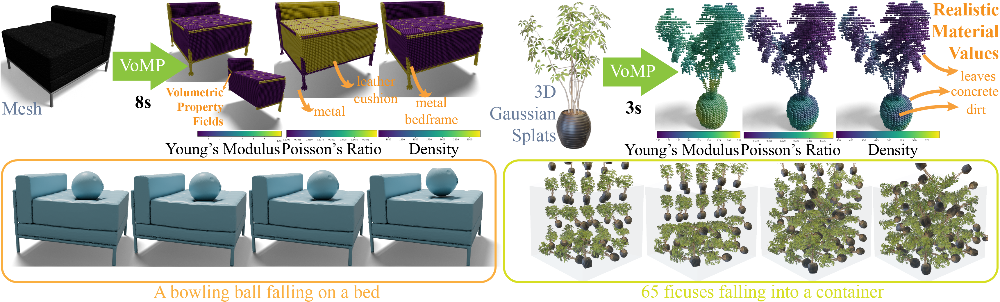
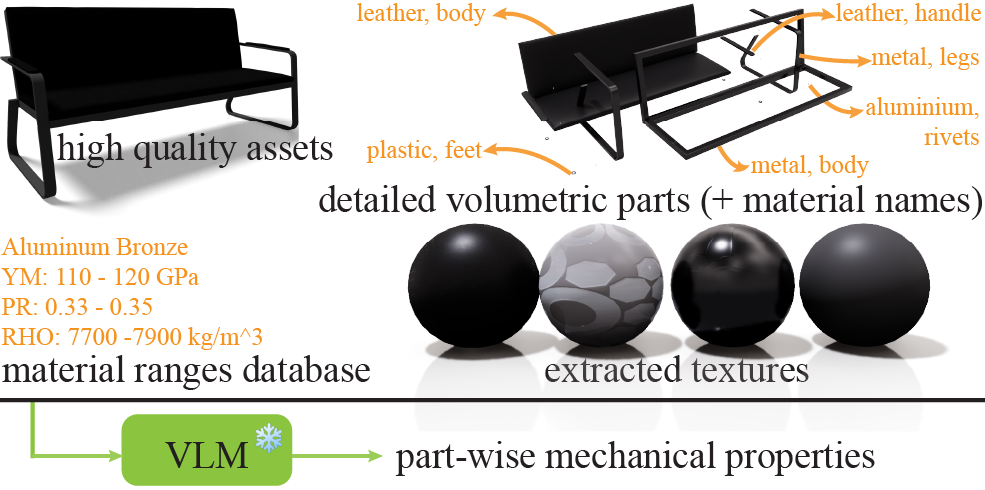

<div align="center">
<h2>VoMP: Predicting Volumetric Mechanical Properties</h2>

<a href="https://arxiv.org/abs/2510.22975"></a>
<a href='https://research.nvidia.com/labs/sil/projects/vomp/'></a>
<a href='https://huggingface.co/nvidia/PhysicalAI-Simulation-VoMP-Model'></a>
<a href='https://huggingface.co/datasets/nvidia/PhysicalAI-Robotics-PhysicalAssets-VoMP'></a>
</div>



This repository provides the implementation of **VoMP**. TL;DR: Feed-forward, fine-grained, physically based volumetric material properties from Splats, Meshes, NeRFs, etc. which can be used to produce realistic worlds.

> [!NOTE]
> This repository now contains VoMP 1.0 and VoMP 1.1. VoMP 1.1 is a more robust model. The instructions in README work for either version, simply change the config file you use.

---

## Contents

- [🔧 Setup](#-setup)
- [📖 Overview of the codebase](#-overview-of-the-codebase)
- [📚 Create the dataset](#-create-the-dataset)
  * [Preprocessed Datasets](#preprocessed-datasets)
  * [Material Triplet Dataset (MTD)](#material-triplet-dataset--mtd-)
  * [Geometry with Volumetric Materials (GVM)](#geometry-with-volumetric-materials--gvm-)
  * [Preparing your own data for training the Geometry Transformer](#preparing-your-own-data-for-training-the-geometry-transformer)
- [💻 Training](#-training)
  * [Training the MatVAE](#training-the-matvae)
  * [Training the Geometry Transformer](#training-the-geometry-transformer)
  * [Training on your own data](#training-on-your-own-data)
  * [Fine-tuning](#fine-tuning)
- [💡 Tips](#-tips)

## 🔧 Setup

Follow the instructions in the [README.md](./README.md) file to set up the environment.

## 📖 Overview of the codebase


The codebase is organized as follows:

- `train_material_vae.py`: Main entry point for training the MatVAE.
- `train_geometry_encoder.py`: Main entry point for training the Geometry Transformer.
- `vomp/`: Main Python package containing all models and utilities.
  - `models/`: Neural network architectures including MatVAE and Geometry Transformer.
    - `geometry_encoder.py`: Geometry Transformer encoder.
    - `material_vae/`: MatVAE model implementations.
    - `structured_latent_vae/`: Structured latent VAE components.
  - `trainers/`: Training frameworks for different model types.
  - `modules/`: Neural network layer classes (sparse transformers, attention, etc.).
  - `datasets/`: Dataset loaders (`SparseVoxelMaterials`, etc.).
  - `representations/`: 3D representation handlers (Gaussian splats).
  - `inference/`: Inference pipeline (`vomp.py`) and utilities.
  - `utils/`: General utility functions and data processing tools.
- `dataset_toolkits/`: Tools for dataset creation and preprocessing.
  - `material_objects/`: Material property rendering, voxelization, and VLM annotation tools.
  - `datasets/`: Dataset loaders (simready, ABO, etc.).
- `configs/`: Configuration files for different experiments.
  - `materials/`: MatVAE and Geometry Transformer configurations.
- `scripts/`: Visualization and evaluation scripts.
- `weights/`: Directory for storing pretrained model weights.

## 📚 Create the dataset

We provide toolkits for data preparation.



### Preprocessed Datasets

We provide the preprocessed datasets (with the vegetation subset removed) at: <a href='https://huggingface.co/datasets/nvidia/PhysicalAI-Robotics-PhysicalAssets-VoMP'></a>. We are unable to make the MTD dataset public due to licenses.

You can also directly download the preprocessed GVM directly to `datasets/simready`:

```bash
huggingface-cli download nvidia/PhysicalAI-Robotics-PhysicalAssets-VoMP --repo-type dataset --local-dir datasets/simready
```

### Material Triplet Dataset (MTD)

First compile the `material_ranges.csv` file by extracting data from the following sources (and deduplicate the data):

- [MatWeb](https://matweb.com/)
- [Engineering Toolbox](https://www.engineeringtoolbox.com/engineering-materials-properties-d_1225.html)
- [Cambridge University Press](https://teaching.eng.cam.ac.uk/sites/teaching.eng.cam.ac.uk/files/Documents/Databooks/MATERIALS%20DATABOOK%20(2011)%20version%20for%20Moodle.pdf)

The Material Triplet Dataset (MTD) is used to train the MatVAE. Assuming you have the `material_ranges.csv` file in the `datasets/latent_space/` directory, you can create the MTD by running the following command:

```bash
python dataset_toolkits/latent_space/make_matvae.py --latent_dir datasets/latent_space/
```

This produces `materials_filtered_vae.csv` for training and `materials_validation_vae.csv` for validation.

Due to the dataset licenses, we cannot provide the `material_ranges.csv` file.

### Geometry with Volumetric Materials (GVM)

The Geometry with Volumetric Materials (GVM) is used to train the Geometry Transformer. First, download the following datasets to `datasets/raw/`:

- [SimReady (13.9 GB + 20.5 GB + 9.4 GB + 21.4 GB + 20.6 GB)](https://docs.omniverse.nvidia.com/usd/latest/usd_content_samples/downloadable_packs.html#simready-warehouse-01-assets-pack)
- [Commercial (5.8 GB)](https://docs.omniverse.nvidia.com/usd/latest/usd_content_samples/downloadable_packs.html#commercial-assets-pack)
- [Residential (22.5 GB)](https://docs.omniverse.nvidia.com/usd/latest/usd_content_samples/downloadable_packs.html#residential-assets-pack)
- [Vegetation (2.7 GB)](https://docs.omniverse.nvidia.com/usd/latest/usd_content_samples/downloadable_packs.html#vegetation-assets-pack)

> [!NOTE]
> The SimReady dataset is split into 5 parts. You can download them all from the aforementioned URL.

Next, unzip these datasets to `datasets/raw/`, to create a directory structure like:

```
datasets/raw/
├── simready/
├── commercial/
├── residential/
├── vegetation/
```

Download the external MDL materials needed for rendering. By default, this saves them under `Materials/`:

```bash
python dataset_toolkits/material_objects/fetch_external_materials.py
```

Then, run the following command to create the GVM. This step takes ~2.5 days on 2 A100 GPUs, assuming you have enough CPU resources, as we perform significant CPU rendering.

```bash
mkdir -p /tmp/vlm datasets/simready

python dataset_toolkits/material_objects/vlm_annotations/main.py \
  --dataset simready residential commercial vegetation \
  -o datasets/simready/material_annotations.json \
  --verbose
```

The VLM prompt is optimized using the `scripts/optimize_prompt.py` script which requires installing [textgrad](https://github.com/zou-group/textgrad).

This saves the annotations to `datasets/simready/material_annotations.json`. Here is one asset from the saved output, with the prompt and analysis abbreviated:

```json
[
  {
    "object_name": "aluminumpallet_a02",
    "category": "pallet",
    "dataset_type": "simready",
    "segments": {
      "RootNode_SM_AluminumPallet_A02_01__whole__54b8ab9d9009": {
        "name": "opaque__metal__aluminium_pallet",
        "opacity": "opaque",
        "material_type": "metal",
        "semantic_usage": "aluminium_pallet",
        "density": 2700,
        "dynamic_friction": 0.1,
        "static_friction": 0.1,
        "restitution": 0.1,
        "prompt": "...",
        "vlm_analysis": "...",
        "youngs_modulus": 68300000000,
        "poissons_ratio": 0.33
      }
    },
    "file_path": "datasets/raw/simready/common_assets/props/aluminumpallet_a02/aluminumpallet_a02_inst_base.usd"
  }
]
```

### Preparing your own data for training the Geometry Transformer

To train VoMP on your own data, you need to prepare a dataset of 3D objects with volumetric materials. Particularly, you need to prepare a JSON file and USD files with the following format:

```json
[
  {
    "object_name": "[object name]",
    "dataset_type": "[dataset label matching preprocessing metadata]",
    "segments": {
      "[segment key returned by the USD segment reader]": {
        "density": 2700.0,
        "youngs_modulus": 70000000000.0,
        "poissons_ratio": 0.33
      }
    },
    "file_path": "path/to/your/object.usd"
  }
]
```

Use each `region.key` from `enumerate_material_regions(stage).regions` in `dataset_toolkits/material_objects/vlm_annotations/usd_segment_reader.py` as a segment key. A region can be a whole mesh or a subset of faces assigned to one material. These keys must match the segment keys generated during rendering. Also make sure the object has appearance properties.

## 💻 Training

### Training the MatVAE

First run `accelerate` config to create a config file, setting your hardware details and if you want to do distributed training. We highly recommend using a single GPU for training MatVAE. This step takes ~12 hours on a single A100 GPU.

Training hyperparameters and model architectures are defined in configuration files under the `configs/` directory. Example configuration files include:

| **Config** | **Description** |
|------------|-----------------|
| `configs/materials/v1.1/material_vae/train.json` | MatVAE training for VoMP 1.1. |
| `configs/materials/v1/material_vae/train.json` | MatVAE training for VoMP 1.0. |
| ... | Training configuration for ablations. |

Any configuration file can be used to start training (use `accelerate launch` instead of `python` if you want to do distributed training),

```bash
python train_material_vae.py --config ...
```

Train the MatVAE by running the following command:

```bash
python train_material_vae.py --config configs/materials/v1.1/material_vae/train.json
```

This creates `outputs/vomp1.1/matvae/`, containing checkpoints, the final model, normalization parameters, and tensorboard logs. Use `configs/materials/v1/material_vae/train.json` for VoMP 1.0.

### Training the Geometry Transformer

Set `dataset.args.roots` in the training config to the preprocessing output directory. Now perform the data preprocessing:

```bash
python dataset_toolkits/build_metadata.py allmats --output_dir datasets/simready
python dataset_toolkits/material_objects/render_usd.py allmats --output_dir datasets/simready --quiet
python dataset_toolkits/build_metadata.py allmats --output_dir datasets/simready --from_file
python dataset_toolkits/material_objects/voxelize.py --output_dir datasets/simready
python dataset_toolkits/build_metadata.py allmats --output_dir datasets/simready --from_file
python dataset_toolkits/extract_feature.py --output_dir datasets/simready
python dataset_toolkits/build_metadata.py allmats --output_dir datasets/simready --from_file
```

Use `--rank` and `--world_size` to shard rendering, voxelization, and feature extraction across processes. Finish every shard before refreshing metadata.

```text
datasets/simready/
├── material_annotations.json
├── metadata.csv
├── renders/    (150 images, cameras, composed mesh, and render manifest)
├── voxels/     (solid occupancy, material labels, and segment identifiers)
├── features/   (DINO features and voxel_row_indices)
└── splits/     (train/val/test metadata)
```

After preprocessing, you can optionally create two rotated copies of each asset, this was added in VoMP 1.1 to not require any specific orientation. This reuses the rendered images and recomputes voxelization and features:

```bash
python dataset_toolkits/material_objects/offline_augment.py prepare --output_dir datasets/simready
python dataset_toolkits/material_objects/offline_augment.py geometry --output_dir datasets/simready
python dataset_toolkits/material_objects/voxelize.py --output_dir datasets/simready \
  --metadata_file datasets/simready/augmentation_metadata.csv
python dataset_toolkits/extract_feature.py --output_dir datasets/simready \
  --metadata_file datasets/simready/augmentation_metadata.csv
python dataset_toolkits/material_objects/offline_augment.py finalize --output_dir datasets/simready
python dataset_toolkits/material_objects/offline_augment.py verify --output_dir datasets/simready
```

The `finalize` step updates `metadata.csv` and the split files.

Train the Geometry Transformer:

```bash
python train_geometry_encoder.py --config configs/materials/v1.1/geometry_encoder/train.json --output_dir outputs/vomp1.1/geometry_encoder
```

### Training on your own data

Once you have prepared your dataset following the format above, training is straightforward.

```bash
python train_geometry_encoder.py --config ... --output_dir ...
```

Replace the config and output directory with your own. You can make a new config file by copying one of the existing ones in the `configs/` directory and modifying the hyperparameters and dataset paths.

### Fine-tuning

Fine-tuning from pre-trained checkpoints is built into the training pipeline, simply run the following command:

```bash
python train_geometry_encoder.py --config ... --output_dir ... --load_dir ... --ckpt latest
```

It searches for models in `<load_dir>/ckpts/` in the following format `geometry_encoder_step[0-9]+.pt` and uses them to continue training. If `--load_dir` is omitted, it uses `<output_dir>/ckpts/`.

```bash
├── geometry_encoder_ema0.9999_step0060000.pt
├── geometry_encoder_ema0.9999_step0200000.pt
├── geometry_encoder_step0060000.pt
├── geometry_encoder_step0200000.pt
├── misc_step0060000.pt
└── misc_step0200000.pt
```

It also optionally searches for the `misc_step[0-9]+.pt` file to restore the optimizer state and scheduler state as well as `geometry_encoder_ema0.9999_step[0-9]+.pt` to restore the EMA model weights.

## 💡 Tips

- Running the model requires 40 GB VRAM. If you often run into out of memory errors, you can reduce the amount of voxels we use for the object.
- Dataset annotation with a VLM uses Qwen2.5-VL-72B which requires ~138 GB VRAM even when you load it in BF16 precision. The dataset annotation was done on 2 A100 GPUs. If you often run into out of memory errors, you can swap for a smaller version of Qwen2.5-VL or some other model, though the annotation would likely be degraded.
